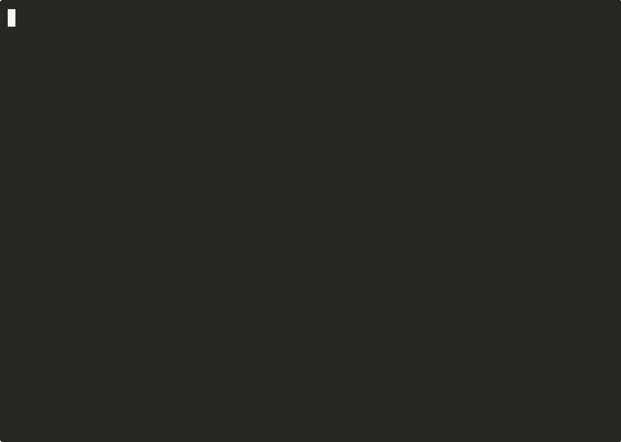

# Arai

An instruction file is advice — the model can read CLAUDE.md and still skip a rule. Arai extracts rules from instruction files (CLAUDE.md, AGENTS.md, .cursorrules, and others). Eligible prohibitions can block matching calls through enabled native hooks; advisory rules inject context, and a tamper-evident audit log records observed firings and compliance.




## Quick Start

```bash
# Unix
curl -sSf https://arai.taniwha.ai/install | sh
# Windows x64: npm install -g @taniwhaai/arai
arai --version

cd your-project
arai init
```

Arai discovers your instruction files, extracts the rules, classifies their intent, scans your codebase for context, and registers native hooks. In Codex, review and enable the project hooks through `/hooks`; writing the configuration does not grant host trust. See [Codex setup and coverage](docs/codex.md).

With **v1.2.1 or newer**, `init`, `scan` and `status` show the same effective policy summary: stored sources and actionable rules, block eligible, advise eligible, documentary/inert and inactive counts. Extracted totals describe ingestion, not active enforcement. Eligibility remains conditional on scope and the actual tool call. `ARAI_DENY_MODE=off` makes otherwise blocking rules advisory; hard bypass (`ARAI_DISABLED=1`) disables enforcement and is shown separately. A successful registration only proves a configuration write; check trust and invocation in your host. Scenario `expect.decision` assertions also require v1.2.1 or newer.

Codex hook support requires **v1.1.2 or newer**. Check `arai --version` after installing; to build from source, run `cargo install --path . --locked` from this checkout.

To also block violating diffs at `git commit` (universal across tools that have no PreToolUse hook):

```bash
arai init --pre-commit
```

Or add this local [pre-commit](https://pre-commit.com) framework hook. It requires an installed `arai` with `check-diff` on PATH; `language: system` does not install Arai. The repository's own `.pre-commit-hooks.yaml` manifest exists from v1.1.2 onward.

```yaml
repos:
  - repo: local
    hooks:
      - id: arai-check-diff
        name: Arai staged-diff check
        entry: arai check-diff --cached
        language: system
        pass_filenames: false
        always_run: true
```


## What It Does

When your AI coding assistant (Claude Code, Grok Build, Codex, or Cursor) is about to do something your rules cover, Arai injects the relevant guardrail. Prohibitive predicates (`never`, `forbids`, `must_not`) can **block a matching tool call** with effective block severity, deny mode enabled and trusted hooks active.

```
You: "Create a new database migration"

  PreToolUse: Write alembic/versions/001_example.py (empty content)
  → Arai: deny
    reason: "Alembic never: hand-write migration files"
            [from CLAUDE.md:3, layer-1 imperative]

Assistant: "I should use alembic revision --autogenerate instead..."
```

This example is reproducible in a fresh project with these exact `CLAUDE.md` bytes (including the blank line):

```markdown
## Alembic

- Never hand-write migration files
```

Run `arai scan`, then replay the Write with empty content under `alembic/`. An unrelated Write to `app/example.py` has no match. The complete [fixture and replay instructions](docs/rule-testing.md#fresh-alembic-fixture) include a scenario asserting deny for the migration Write and allow for the unrelated Write and skipped Read. Scenario decisions describe effective policy. Native stdin replay proves the handler response, while live host enforcement requires separate host evidence.

Arai records observed rule firings in a local audit log on a best-effort basis. PostToolUse handling can produce **Obeyed / Ignored / Unclear** verdicts using recent firings and word-level evidence. These heuristics help review patterns across sessions.


## How It Works

1. **Discovers** instruction files in your project and home directory
2. **Extracts** rules by pattern-matching imperative language ("never", "always", "don't", "must")
3. **Classifies** each rule's intent — what action it governs, which tools it applies to, when it should fire
4. **Scans** your codebase with tree-sitter to understand which tools own which directories
5. **Tracks** session state — knows if you've already run tests before pushing
6. **Fires** only relevant rules at the right moment via native hooks (where supported)


## Supported Instruction Files

| File | Tool | Enforcement |
|------|------|-------------|
| `CLAUDE.md` | Claude Code | Hooks (block + advise) |
| `.claude/rules/**/*.md` | Claude Code | Path-scoped hooks (block + advise) |
| `AGENTS.md` / `Agents.md` | Grok Build (native) | Hooks (block; advise best-effort) |
| `AGENTS.md` / `Agents.md` | Codex (native) | Hooks (block + advise; requires host trust) |
| `~/.claude/CLAUDE.md` | Claude Code (global) | Hooks (block + advise) |
| `~/.grok/` AGENTS.* files | Grok Build (global) | Hooks (block; advise best-effort) |
| `.cursorrules` / `.cursor/rules` | Cursor | Hooks (block; advise at session start and after tool calls) |
| `.windsurfrules` | Windsurf | MCP (advise) |
| `.github/copilot-instructions.md` | GitHub Copilot | Hooks (block; advise at session start) |

Rules from every file are parsed, classified, and stored the same way — but
enforcement strength depends on what surface the assistant exposes.

Nested instructions retain directory scope; Claude `paths` and Cursor `globs`
restrict file actions. Local scans preserve externally managed policy and prune
only sources they own. Existing stores require explicit adoption of legacy local
sources. See [discovery, activation and upgrade handling](docs/instruction-discovery.md)
and [Arai's place upstream of Kete](docs/stack-integration.md).

On Windows, project state uses the resolved directory path so long names,
8.3 aliases, case variants, and PowerShell hooks share one store. See
[Windows state upgrades](docs/instruction-discovery.md#windows-project-state-upgrades)
if you already have state created under a different path spelling.

- **Claude Code**, **Grok Build**, **Codex**, and **Cursor** support PreToolUse
  hooks, so Arai can issue `deny` decisions and actually block tool calls.
- On **Claude Code**, hooks in `.claude/settings.json` run only once the
  workspace is trusted. Accept the trust prompt for the folder, or the
  registration stays inactive. A `tool.check` Mod can override a hook deny in
  sessions without managed settings or a Team or Enterprise `/login`.
  See [Claude Code integration](docs/claude.md).
- On **Grok Build**, project hooks run after workspace trust. The headless
  and ACP probes on **1.0.77** confirmed `decision: deny` and exit 2 block the
  call. Arai emits advisory text as `additionalContext` and records it in
  the audit log. Model delivery of advisory text is best-effort.
  [Grok Build probe notes](docs/upstream/grok-hooks-reverification-2026-11.md)
- Codex registers `PreToolUse`, `PostToolUse`, and `UserPromptSubmit` in
  `.codex/hooks.json`. Shell calls use the host's canonical `Bash` payload;
  `apply_patch` is checked per file, including additions and move destinations.
  Enable the hooks with `/hooks` after `arai init`; see [coverage and limits](docs/codex.md).
- **Cursor** registers `preToolUse` (with `failClosed`), `postToolUse`,
  `afterFileEdit`, and `sessionStart` in `.cursor/hooks.json`. Block is
  load-bearing on `preToolUse`. Advisory text reaches the model through the
  session-start summary and post-tool context. See [coverage and limits](docs/cursor.md).
- **GitHub Copilot** registers `preToolUse`, `postToolUse`, and `sessionStart`
  in `.github/hooks/arai.json`. A block is a flat `permissionDecision: deny`.
  Advisory text reaches the model at session start. `postToolUse` records the
  call and uses `additionalContext` when a rule matches that event.
  The Copilot cloud agent enforces only when the `arai` binary exists at the
  path `arai init` recorded; a missing binary exits 0. This follows the
  published hooks reference and was not probed against a live Copilot CLI.
  See [coverage and limits](docs/copilot.md).
- Arai's integrations for Windsurf, Cline and other MCP clients provide **agent-facing tools**
  (`arai_list_guards`, `arai_add_guard`, `arai_check_action`, `arai_recent_decisions`) — not
  automatic tool-call inject/deny. Blocking still needs a native PreToolUse
  host.

[Host probe notes](docs/README.md#host-probe-notes) record versions, commands,
decisions and audit evidence.

Arai hooks several more events alongside the standard tool-call events
**when the host emits them** so the rule set stays accurate to the live
working tree:

- **`SessionStart`** (Codex, Grok Build, Cursor, Copilot) — those hosts do not emit
  instruction-change events, so at session start Arai checks whether an
  instruction file was added, removed or modified since the last scan and,
  only then, re-scans in the background. Updated rules become available
  after that scan finishes. Run `arai scan` for an immediate refresh or
  after a mid-session edit on these hosts.
- **`FileChanged` + `InstructionsLoaded`** (Claude Code) — when an instruction file
  (CLAUDE.md, rules-dir, memory file, ...) is edited on disk or loaded
  into context, Arai spawns an `arai scan` in the background. Tool-call
  hooks see the updated guardrails after the scan finishes.
- **`CwdChanged`** (Claude Code) — when Claude `cd`s into a different directory
  (monorepo navigation), Arai re-scans rooted at the new directory so
  subsequent tool calls use the refreshed rules after the scan finishes.
- **`PostToolBatch`** (Claude Code) — when Claude does a batch of parallel tool calls,
  Arai applies the same best-effort compliance correlation to each call.
  Correlation uses session, tool and time; parallel calls can overlap.

Run `arai scan` after editing instruction files mid-session on hosts without
the file events.


## Smart Matching

Arai doesn't just do keyword matching. It understands your rules:

- **Intent classification** — the Alembic heading and migration rule above classify as a creation prohibition; eligibility alone does not prove a match
- **Code graph** — scanned imports can supply tool context; a `migrations/` path alone does not prove an Alembic match
- **Content sniffing** — detects `from alembic import op` in file content being written
- **Session awareness** — "never push without running tests" suppresses after tests have been run
- **Timing routing** — domain rules fire on tool calls, principles stay silent (already in CLAUDE.md)
- **Broad imperative coverage** — recognises `never/always/don't/must`, `should/shouldn't`, `cannot/refuse`, `make sure/be sure`, `consider/recommend`, bare `No X` prohibitions, conditional shapes (`When X, do Y` / `Before X: do Y` / `If X → do Y`), and the section-aware `Use X` style-guide pattern. Severity mapping mirrors grammatical weight: `should` is `Inform` (soft), `should not` is `Block` (the writer chose to call out a specific prohibition).


## Why not just an instruction file?

| An instruction file alone | With Arai |
|---|---|
| Advice the model can skip under pressure | Prohibitions deny the tool call at the hook |
| No record of what was ignored | Hash-chained audit log; `arai audit --verify` |
| You hope it listened | Per-rule obeyed / ignored / unclear verdicts |
| Rewrite rules into a new policy format | Your existing files *are* the policy |


## Commands

```bash
arai init                  # Discover, extract, classify, scan, set up hooks
arai init --pre-commit     # Also install a git hook: arai check-diff --cached
arai deinit                # Remove Arai hook registrations; leave other handlers
arai status                # Show what's being enforced
arai guardrails            # List all active rules
arai why "git push --force" # Explain which rules would fire (dry-run, no audit write)
arai check-diff --cached   # Match the staged diff against guardrails (repo layer)
arai scan                  # Re-scan instruction files
arai scan --code           # Also scan source code (tree-sitter AST)
arai scan --enrich-llm     # Enhance rules via LLM CLI
arai scan --enrich-api     # Enhance rules via API (OpenAI-compatible)
arai add "Never hand-write alembic migration files" # Add a rule; test the actual call
arai add --allow-inert "…" # Keep a documentary rule that will not enforce
arai disable 42            # Silence a rule by triple-id (survives rescan)
arai enable 42             # Re-enable a previously disabled rule
arai audit                 # Inspect the local log of rule firings
arai audit --outcome=ignored # Compliance verdicts where the model ignored a rule
arai audit --rule alembic  # Filter audit by rule subject/predicate/object substring
arai audit --verify        # Verify the SHA-256 hash chain across every day-bucket
arai audit --ship          # Ship pending day-buckets to your collector
arai audit --purge --older=90  # Drop day-buckets older than 90 days
arai stats                 # Aggregate audit log — top rules, compliance, token economics
arai stats --by-rule       # Just the per-rule compliance + token economics
arai severity alembic block # Pin a rule's severity (incremental deny rollout)
arai severity --reset alembic # Drop the override; severity reverts to predicate-derived
arai diff CLAUDE.md        # Preview rule-set delta before saving an edit
arai test scenarios.json   # Replay synthetic hook scenarios against rules
arai record --since=1h     # Capture recent firings as a scenario skeleton
arai lint CLAUDE.md        # Parse a file and preview extracted rules
arai canonicalize          # Extract recognised rules into ./arai.toml
arai sync                  # Write arai.toml into existing per-tool instruction files
arai trust                 # Manage URLs trusted for shared-policy extends
arai mcp                   # Run the MCP server (stdio) for agent-authored guards
arai migrate               # Move legacy ~/.arai → ~/.taniwha/arai
arai upgrade --full        # Switch to full binary (with ONNX enrichment)
```


## Compliance & audit

Arai keeps a best-effort local record of observed rule firings and selected
events, with hash-chain checks and heuristic compliance verdicts for review.

- **Local JSONL audit log** — one line per firing at
  `~/.taniwha/arai/audit/<project>/<YYYYMMDD>.jsonl`. Append-only, day-bucketed,
  queryable with `arai audit` (filters: `--since`, `--tool`, `--event`,
  `--outcome`, `--rule`). Owner-only on disk (0700 dir / 0600 file on Unix;
  `icacls`-pinned on Windows).
- **Hash-chain checks** — each new line carries `prev_hash` and `hash`
  (SHA-256 over canonical bytes). `arai audit --verify` checks hashes and
  links within existing day-buckets and exits non-zero on detected issues.
  The command validates the existing bucket contents. Detecting removed
  complete tails or whole buckets requires separately retained checkpoints
  and bucket inventory.
- **Bring your own collector** — `arai audit --ship <url>` sends pending
  day-buckets *with their chain-head sidecars* to your own HTTPS
  collector for server-side verification. Resume cursor,
  idempotent re-ship, optional bearer auth via env var, explicit opt-in
  only. See [docs/audit-ship.md](docs/audit-ship.md) for the payload
  and a minimal collector.
- **Retention controls** — `arai audit --purge --older=90` drops day-buckets
  older than 90 days; `arai audit --purge --project=<slug>` wipes a specific
  project (offboarding / decommission). Today's bucket is always preserved
  and whole files are deleted (never individual lines), so the hash chain on
  retained days stays valid. Pair with `--dry-run` (and `--json`) for a
  pre-purge review, or wire into a scheduled job for time-based retention
  policy.
- **Derivation trace per firing** — each rule entry records source file,
  line number, and parser layer (`from CLAUDE.md:42, layer-1 imperative`).
  Auditors can answer "why did this rule fire?" without code spelunking.
- **Compliance verdicts** — PostToolUse handling searches up to 50 recent
  PreToolUse entries for the same tool within five minutes, then filters by
  session. Word-level evidence produces **Obeyed / Ignored / Unclear** per
  rule. Correlation keys are session, tool and time window.
  `arai stats --by-rule` aggregates these
  heuristic verdicts into ratios with a ⚠ flag for low-ratio rules.
- **Graduated enforcement** — severity tiers (Block / Warn / Inform) derive
  from rule predicate; `arai severity` pins individual rules so you can
  ship a rule set in advise mode and escalate one at a time.
  `ARAI_DENY_MODE=off` is the project-wide rollback path.
- **Regression-tested policy** — `arai test` replays scenarios through the
  live matching and effective decision logic with `deny` / `advise` / `allow`
  assertions; `arai record` captures real firings as
  fixtures. Rule changes become CI assertions, not vibes.
- **Local audit by default** — audit writes stay local on the hook hot path;
  shipping to a collector requires explicit configuration and invocation.
  Anonymous opt-out telemetry uses a separate event schema and queue,
  hard-capped at 2 MiB on disk.
- **Download verification** — `install.sh` and npm verify downloaded binaries
  against published `checksums.txt` (SHA-256) by default. `arai:extends` upstream
  policy fetches refuse loopback / RFC1918 / link-local / cloud metadata
  and disable redirects; **cached upstream policies carry a SHA-256
  sidecar** so a tampered cache file is detected before its rules reach
  the parser.
- **MCP authentication** — the agent-facing MCP server supports an optional
  shared-secret via `ARAI_MCP_AUTH_TOKEN`. When set, `initialize` must
  present a matching token (constant-time compare) before any tool call
  succeeds.

Designed to align with the **SOC 2 Trust Service Criteria** (CC6.1 logical
access, CC6.6 supply-chain, CC7.2 monitoring, CC7.3 detection, CC8.1 change
management, CC9.2 vendor management). Arai is not itself a certified
product — it gives you the controls and the evidence trail; the
certification is yours to pursue. A complete TSC mapping and enterprise /
procurement-team feature inventory is in
[`docs/arai-compliance-features.pdf`](docs/arai-compliance-features.pdf).
The Word source (`.docx`) is committed alongside it for editing.


## Installation

```bash
# Unix install script
curl -sSf https://arai.taniwha.ai/install | sh

# Full binary (with local sentence transformer)
curl -sSf https://arai.taniwha.ai/install | ARAI_FULL=1 sh

# npm (supported Windows x64 route, also available on Unix)
npm install -g @taniwhaai/arai
arai --version

# Cargo
cargo install arai
cargo install arai --features enrich   # with ONNX model support

# Homebrew
brew install taniwhaai/tap/arai

# Docker (sandboxed install or CI-side enforcement)
docker build -t arai .
docker run --rm -i -v "$(pwd)/.taniwha/arai:/home/arai/.taniwha/arai" arai
# Or via compose with a persistent named volume:
docker compose run --rm arai
```

Native Windows ARM64 is not supplied by the npm installer; use its x64 emulation or source-build instructions. The Unix script is not a PowerShell installer. Cargo is the existing source alternative. When measuring the five-minute first-run journey target, record installation and sign-in time separately; five minutes is not a runtime timeout.

### Verifying release binaries with cosign

Every release binary is signed in CI using [cosign](https://docs.sigstore.dev/cosign/overview/)
keyless signing via the GitHub OIDC token. The signing certificate is
issued by Fulcio and bound to this repo's release workflow, so verifiers
pin to the workflow identity instead of a long-lived public key. No
private keys, no key rotation.

The `install.sh` and `npm` paths verify SHA-256 checksums by default,
which is enough to catch a corrupted download but not a substituted one.
For higher-assurance environments, verify the cosign signature before
running the binary:

```bash
# 1. Download the binary, its .cosign.bundle, and (optionally) checksums.txt
VERSION=v1.2.1
FILE=arai-linux-x86_64
curl -fL -o "$FILE"               "https://github.com/taniwhaai/arai/releases/download/${VERSION}/${FILE}"
curl -fL -o "${FILE}.cosign.bundle" "https://github.com/taniwhaai/arai/releases/download/${VERSION}/${FILE}.cosign.bundle"

# 2. Verify the signature is bound to this repo's release workflow
cosign verify-blob \
  --bundle "${FILE}.cosign.bundle" \
  --certificate-identity-regexp '^https://github\.com/taniwhaai/arai/\.github/workflows/ci\.yml@refs/tags/v.*' \
  --certificate-oidc-issuer https://token.actions.githubusercontent.com \
  "$FILE"
```

A successful verification prints `Verified OK` and exits 0. Failure
exits non-zero — do not run the binary.

The `--certificate-identity-regexp` and `--certificate-oidc-issuer`
flags are the load-bearing ones: they assert that the signing
certificate was issued to *this* repo's CI workflow on a tag push, not
to some attacker's fork. Loosening either flag defeats the point.

### Verifying SLSA L3 provenance

cosign answers *"was this binary signed by this repo's CI?"*. SLSA
provenance answers the harder question: *"how was this binary built —
which commit, which workflow, which inputs?"*. Together they cover
both the signing identity (cosign) and recorded build details (SLSA), so
verifiers can check the expected source and tag and inspect the recorded
workflow and inputs.

Releases include a single `multiple.intoto.jsonl` attestation generated
by the [SLSA GitHub generator](https://github.com/slsa-framework/slsa-github-generator).
Verify consumer-side with [`slsa-verifier`](https://github.com/slsa-framework/slsa-verifier):

```bash
# 1. Download the binary and the release-level provenance attestation
VERSION=v1.2.1
FILE=arai-linux-x86_64
curl -fL -o "$FILE" \
  "https://github.com/taniwhaai/arai/releases/download/${VERSION}/${FILE}"
curl -fL -o multiple.intoto.jsonl \
  "https://github.com/taniwhaai/arai/releases/download/${VERSION}/multiple.intoto.jsonl"

# 2. Verify the binary against the provenance, pinned to this repo + tag
slsa-verifier verify-artifact \
  --provenance-path multiple.intoto.jsonl \
  --source-uri github.com/taniwhaai/arai \
  --source-tag "${VERSION}" \
  "$FILE"
```

A successful verification prints `PASSED: SLSA verification passed` and
exits 0. Failure exits non-zero — do not run the binary.

`--source-uri` is the load-bearing flag: it asserts that the provenance
was produced from a build of this repo's source. `--source-tag` (or
`--source-branch`) further pins to a specific release.

### What each layer protects against

| Attack | SHA-256 checksums | cosign keyless | SLSA L3 provenance |
|---|---|---|---|
| Corrupted download | ✅ caught | ✅ caught | ✅ caught |
| Substituted binary at release | ❌ checksums.txt would also be swapped | ✅ certificate identity ≠ this repo's workflow | ✅ provenance source-uri ≠ this repo |
| Stolen release-pipeline secret | ❌ | ✅ no long-lived secret to steal | ✅ provenance binds to specific workflow run |
| Unexpected source or inputs in the build record | ❌ | ❌ | Provenance exposes the recorded workflow, commit, and inputs for inspection |

SHA-256 stays the default in `install.sh` / `npm` because it doesn't
require any extra tooling client-side. cosign and SLSA are opt-in for
environments that need the higher tier.


## Performance

| Operation | Median | p95 |
|-----------|--------|-----|
| Hook check (skip-tool — Read/Glob/Agent) | ~22 ms | ~36 ms |
| Hook check (full match pipeline) | ~32 ms | ~55 ms |

These historical local Linux/WSL subprocess figures need a fresh measurement
for the current release and host. `bench/hot_path.sh` times direct binary launch, matching
and exit with synthetic rules. It excludes assistant dispatch and response
handling, and does not measure full init. Re-run it in your environment to
compare changes; host and installation timing vary.


## Telemetry

Arai collects anonymous usage data to help us understand if guardrails are actually useful. We track:

- Whether a rule fired and on which tool
- Hook response latency
- Rule counts and enrichment tier on init

We **never** collect file paths, rule text, code content, API keys, or anything that could identify you or your codebase.

**Opt out** at any time:

```bash
export ARAI_TELEMETRY=off   # or DO_NOT_TRACK=1
```

or in `~/.taniwha/arai/config.toml`:

```toml
[telemetry]
enabled = false
```

### Self-hosted collector

Organizations that want the usage signal on **their own
infrastructure** can point the existing queue at their own endpoint —
same events, same anonymity constraints, your retention rules:

```toml
[telemetry]
endpoint = "https://collector.example.com/arai"
bearer_env = "ARAI_TELEMETRY_TOKEN"   # optional; env var NAME, not the token
```

Default behavior is unchanged when `endpoint` is unset. Opt-outs win
regardless of endpoint. HTTPS required (plain HTTP allowed only for
loopback dev collectors), batches retry on failure, and the payload
schema is documented in
[docs/telemetry-payload.md](docs/telemetry-payload.md) so you know
exactly what you're receiving. The audit log remains a separate channel,
local by default, with explicit opt-in shipping through `arai audit --ship`.


## Going deeper

The sections above are enough to install Arai and see it block. The full
capability set is documented in focused guides:

- [Enforcement in depth](docs/enforcement.md) — deny mode, per-rule severity
  rollout (`arai severity`), dry-run explanations (`arai why`), compliance
  verdicts, rule expiry
- [The audit log](docs/audit.md) — querying, `--verify` chain checks,
  `arai status`, `arai stats`, token economics
- [Shipping the audit trail](docs/audit-ship.md) — `arai audit --ship` to
  your own collector, with server-side chain verification
- [Testing your rule set](docs/rule-testing.md) — `arai diff`, `arai lint`,
  `arai test`, `arai record`
- [Shared policies](docs/extends.md) — `arai:extends`, trust list, pinning,
  signatures, private policy sources
- [MCP integration](docs/mcp.md) — agent-authored guards for Cursor,
  Windsurf, and any MCP client (`arai_check_action` included)
- [Codex setup](docs/codex.md) — `.codex/hooks.json`, `/hooks` trust, `apply_patch`
- [Instruction discovery](docs/instruction-discovery.md) — nested files, Claude `paths`, Cursor `globs`
- [Canonical `arai.toml`](docs/rules-file-spec.md) — `arai canonicalize` / `arai sync`
- [Arai upstream of Kete](docs/stack-integration.md)
- [Rule enrichment](docs/enrichment.md) — the three classification tiers
- [Telemetry payload schema](docs/telemetry-payload.md) — what a
  self-hosted collector receives


## Built By

[Taniwha.ai](https://taniwha.ai) — extracted from the [Kete](https://github.com/taniwhaai/kete) code intelligence platform.


## License

Licensed under either of

- Apache License, Version 2.0 ([LICENSE-APACHE](LICENSE-APACHE) or <http://www.apache.org/licenses/LICENSE-2.0>)
- MIT license ([LICENSE-MIT](LICENSE-MIT) or <http://opensource.org/licenses/MIT>)

at your option.

Unless you explicitly state otherwise, any contribution intentionally submitted
for inclusion in the work by you, as defined in the Apache-2.0 license, shall be
dual licensed as above, without any additional terms or conditions.

## Trademarks

"Arai", "Kete", and "Taniwha" are trademarks of Taniwhaai Limited. The source
licenses above grant no rights to these marks — see [NOTICE](NOTICE). You are
welcome to fork this project; please distribute forks under a different name.
